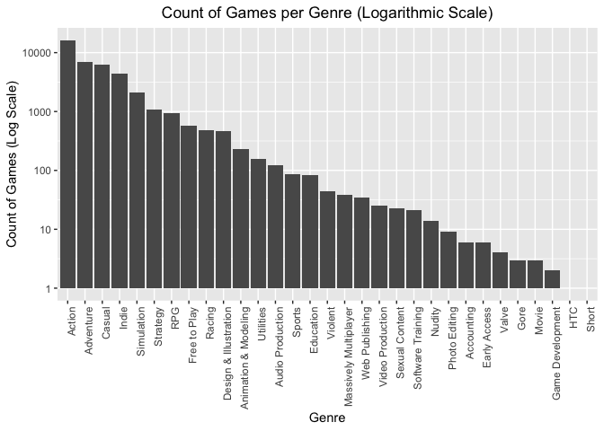
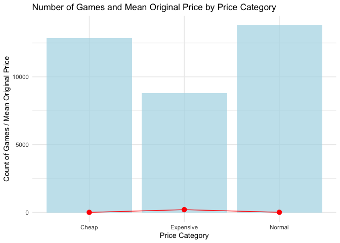
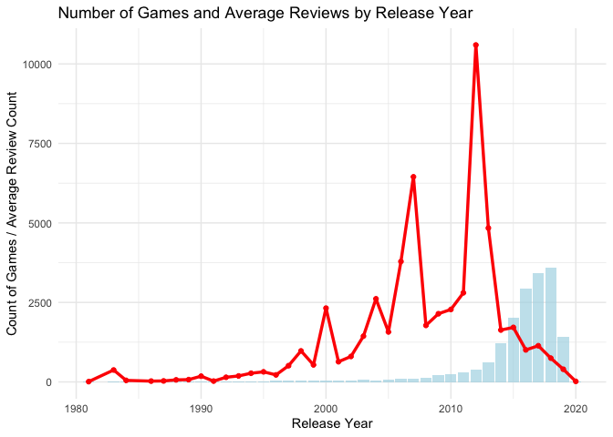
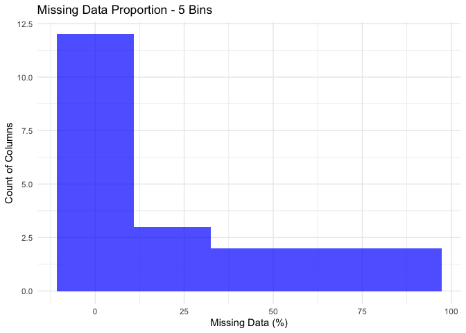
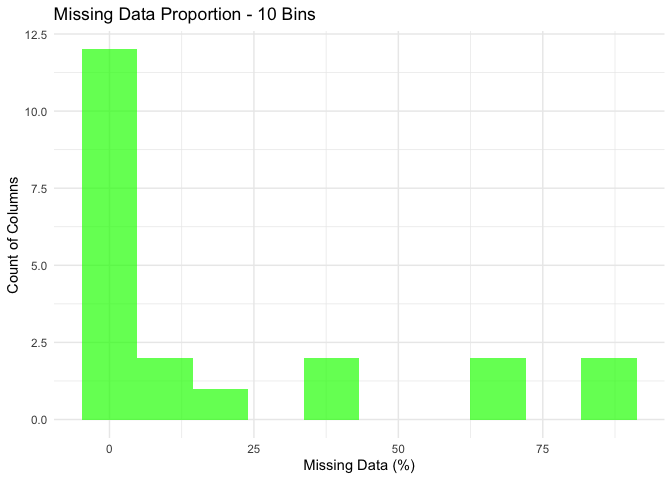
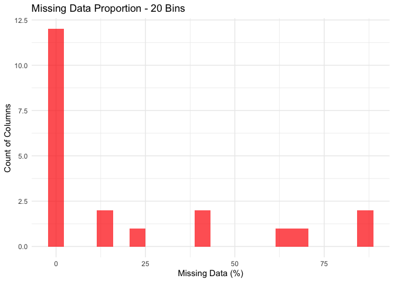

Mini Data Analysis Milestone 2
================

*To complete this milestone, you can either edit [this `.rmd`
file](https://raw.githubusercontent.com/UBC-STAT/stat545.stat.ubc.ca/master/content/mini-project/mini-project-2.Rmd)
directly. Fill in the sections that are commented out with
`<!--- start your work here--->`. When you are done, make sure to knit
to an `.md` file by changing the output in the YAML header to
`github_document`, before submitting a tagged release on canvas.*

# Welcome to the rest of your mini data analysis project!

In Milestone 1, you explored your data. and came up with research
questions. This time, we will finish up our mini data analysis and
obtain results for your data by:

- Making summary tables and graphs
- Manipulating special data types in R: factors and/or dates and times.
- Fitting a model object to your data, and extract a result.
- Reading and writing data as separate files.

We will also explore more in depth the concept of *tidy data.*

**NOTE**: The main purpose of the mini data analysis is to integrate
what you learn in class in an analysis. Although each milestone provides
a framework for you to conduct your analysis, it’s possible that you
might find the instructions too rigid for your data set. If this is the
case, you may deviate from the instructions – just make sure you’re
demonstrating a wide range of tools and techniques taught in this class.

# Instructions

**To complete this milestone**, edit [this very `.Rmd`
file](https://raw.githubusercontent.com/UBC-STAT/stat545.stat.ubc.ca/master/content/mini-project/mini-project-2.Rmd)
directly. Fill in the sections that are tagged with
`<!--- start your work here--->`.

**To submit this milestone**, make sure to knit this `.Rmd` file to an
`.md` file by changing the YAML output settings from
`output: html_document` to `output: github_document`. Commit and push
all of your work to your mini-analysis GitHub repository, and tag a
release on GitHub. Then, submit a link to your tagged release on canvas.

**Points**: This milestone is worth 50 points: 45 for your analysis, and
5 for overall reproducibility, cleanliness, and coherence of the Github
submission.

**Research Questions**: In Milestone 1, you chose four research
questions to focus on. Wherever realistic, your work in this milestone
should relate to these research questions whenever we ask for
justification behind your work. In the case that some tasks in this
milestone don’t align well with one of your research questions, feel
free to discuss your results in the context of a different research
question.

# Learning Objectives

By the end of this milestone, you should:

- Understand what *tidy* data is, and how to create it using `tidyr`.
- Generate a reproducible and clear report using R Markdown.
- Manipulating special data types in R: factors and/or dates and times.
- Fitting a model object to your data, and extract a result.
- Reading and writing data as separate files.

# Setup

Begin by loading your data and the tidyverse package below:

``` r
library(datateachr) # <- might contain the data you picked!
library(tidyverse)
library(dplyr)
library(ggplot2)
library(stringr)
library(broom)
library(here)
```

# Task 1: Process and summarize your data

From milestone 1, you should have an idea of the basic structure of your
dataset (e.g. number of rows and columns, class types, etc.). Here, we
will start investigating your data more in-depth using various data
manipulation functions.

### 1.1 (1 point)

First, write out the 4 research questions you defined in milestone 1
were. This will guide your work through milestone 2:

<!-------------------------- Start your work below ---------------------------->

1.  How do discount price vary across different genres of games, and are
    certain genres more likely to have larger discounts? Understanding
    how discounts are applied across genres could provide insights into
    pricing strategies within the gaming industry. Some genres may be
    more prone to sales and discounts, which could indicate trends in
    user demand or marketing strategies.

2.  Is there a relationship between the original price of a game and the
    number of user reviews it receives? This question explores whether
    higher-priced games receive more attention and reviews from users or
    whether users are more engaged with lower-priced games.

3.  How does the release date of a game affect its discounting and user
    review patterns? Are older games more likely to have larger
    discounts or higher review counts? This question delves into the
    dynamics of game life cycles, looking at whether older games tend to
    have higher discounts and more reviews due to their established
    presence.

4.  What factors influence whether a game has missing data in key
    variables (e.g., recent reviews, system requirements, discount
    information)? Why it’s interesting: Missing data can skew analysis,
    and understanding what causes certain variables to be missing can
    help assess data quality and reliability. This might reveal insights
    into which types of games are more likely to lack certain
    information.

    <!----------------------------------------------------------------------------->

Here, we will investigate your data using various data manipulation and
graphing functions.

### 1.2 (8 points)

Now, for each of your four research questions, choose one task from
options 1-4 (summarizing), and one other task from 4-8 (graphing). You
should have 2 tasks done for each research question (8 total). Make sure
it makes sense to do them! (e.g. don’t use a numerical variables for a
task that needs a categorical variable.). Comment on why each task helps
(or doesn’t!) answer the corresponding research question.

Ensure that the output of each operation is printed!

Also make sure that you’re using dplyr and ggplot2 rather than base R.
Outside of this project, you may find that you prefer using base R
functions for certain tasks, and that’s just fine! But part of this
project is for you to practice the tools we learned in class, which is
dplyr and ggplot2.

**Summarizing:**

1.  Compute the *range*, *mean*, and *two other summary statistics* of
    **one numerical variable** across the groups of **one categorical
    variable** from your data.
2.  Compute the number of observations for at least one of your
    categorical variables. Do not use the function `table()`!
3.  Create a categorical variable with 3 or more groups from an existing
    numerical variable. You can use this new variable in the other
    tasks! *An example: age in years into “child, teen, adult, senior”.*
4.  Compute the proportion and counts in each category of one
    categorical variable across the groups of another categorical
    variable from your data. Do not use the function `table()`!

**Graphing:**

6.  Create a graph of your choosing, make one of the axes logarithmic,
    and format the axes labels so that they are “pretty” or easier to
    read.
7.  Make a graph where it makes sense to customize the alpha
    transparency.

Using variables and/or tables you made in one of the “Summarizing”
tasks:

8.  Create a graph that has at least two geom layers.
9.  Create 3 histograms, with each histogram having different sized
    bins. Pick the “best” one and explain why it is the best.

Make sure it’s clear what research question you are doing each operation
for!

<!------------------------- Start your work below ----------------------------->

#### 1.2.1 Research question 1

How do discount price vary across different genres of games?

**Summarizing Task:** count the number of observations for the **genre**
variable.

``` r
# Extract the first genre before the comma
steam_games_cleaned <- steam_games %>%
  mutate(first_genre = str_split(genre, ",", simplify = TRUE)[, 1]) %>%  # Extract the first genre
  filter(!is.na(first_genre))  # Remove rows with NA in first_genre

steam_games_cleaned
```

    ## # A tibble: 40,395 × 22
    ##       id url    types name  desc_snippet recent_reviews all_reviews release_date
    ##    <dbl> <chr>  <chr> <chr> <chr>        <chr>          <chr>       <chr>       
    ##  1     1 https… app   DOOM  Now include… Very Positive… Very Posit… May 12, 2016
    ##  2     2 https… app   PLAY… PLAYERUNKNO… Mixed,(6,214)… Mixed,(836… Dec 21, 2017
    ##  3     3 https… app   BATT… Take comman… Mixed,(166),-… Mostly Pos… Apr 24, 2018
    ##  4     4 https… app   DayZ  The post-so… Mixed,(932),-… Mixed,(167… Dec 13, 2018
    ##  5     5 https… app   EVE … EVE Online … Mixed,(287),-… Mostly Pos… May 6, 2003 
    ##  6     6 https… bund… Gran… Grand Theft… NaN            NaN         NaN         
    ##  7     7 https… app   Devi… The ultimat… Very Positive… Very Posit… Mar 7, 2019 
    ##  8     8 https… app   Huma… Human: Fall… Very Positive… Very Posit… Jul 22, 2016
    ##  9     9 https… app   They… They Are Bi… Very Positive… Very Posit… Dec 12, 2017
    ## 10    10 https… app   Warh… In a world … <NA>           Mixed,(904… May 31, 2019
    ## # ℹ 40,385 more rows
    ## # ℹ 14 more variables: developer <chr>, publisher <chr>, popular_tags <chr>,
    ## #   game_details <chr>, languages <chr>, achievements <dbl>, genre <chr>,
    ## #   game_description <chr>, mature_content <chr>, minimum_requirements <chr>,
    ## #   recommended_requirements <chr>, original_price <dbl>, discount_price <dbl>,
    ## #   first_genre <chr>

``` r
# Count the number of observations for each first genre
genre_counts <- steam_games_cleaned %>%
  group_by(first_genre) %>%
  summarize(count = n())

# View the summary table
print(genre_counts)
```

    ## # A tibble: 31 × 2
    ##    first_genre           count
    ##    <chr>                 <int>
    ##  1 Accounting                6
    ##  2 Action                16290
    ##  3 Adventure              6854
    ##  4 Animation & Modeling    231
    ##  5 Audio Production        122
    ##  6 Casual                 6348
    ##  7 Design & Illustration   471
    ##  8 Early Access              6
    ##  9 Education                83
    ## 10 Free to Play            577
    ## # ℹ 21 more rows

**Graphing Task**: Create a graph with a logarithmic axis and readable
labels.

``` r
# Create the bar plot with a logarithmic y-axis
ggplot(genre_counts, aes(x = reorder(first_genre, -count), y = count)) +
  geom_bar(stat = "identity") +
  scale_y_log10() +  # Apply logarithmic scale to the y-axis
  labs(title = "Count of Games per Genre (Logarithmic Scale)",
       x = "Genre",
       y = "Count of Games (Log Scale)") +
  theme(axis.text.x = element_text(angle = 90, hjust = 1),  # Rotate x-axis labels for readability
        plot.title = element_text(hjust = 0.5))  # Center the title
```

<!-- -->

#### 1.2.2 Research question 2

Is there a relationship between the original price of a game and the
number of user reviews it receives?

**Summarizing Task:** creating a new **categorical variable** based on
the **original_price** column, we’ll divide the prices into three
categories: **cheap**, **normal**, and **expensive**.

``` r
steam_games_prices <- steam_games %>%
  filter(!is.na(original_price)) %>%
  mutate(price_category = case_when(
    original_price <= quantile(original_price, 0.33, na.rm = TRUE) ~ "Cheap",
    original_price <= quantile(original_price, 0.66, na.rm = TRUE) ~ "Normal",
    TRUE ~ "Expensive"
  ))

# Check the new price category variable
head(steam_games_prices %>% select(original_price, price_category))
```

    ## # A tibble: 6 × 2
    ##   original_price price_category
    ##            <dbl> <chr>         
    ## 1           20.0 Expensive     
    ## 2           30.0 Expensive     
    ## 3           40.0 Expensive     
    ## 4           45.0 Expensive     
    ## 5            0   Cheap         
    ## 6           60.0 Expensive

**Graphing Task:** the **count of games in each price category** as the
main plot, and the **mean original price** within each price category.

``` r
# Create a bar plot with count of games in each price category and overlay mean original price
ggplot(steam_games_prices, aes(x = price_category)) +
  geom_bar(aes(y = after_stat(count)), fill = "lightblue", alpha = 0.7) +  # Bar chart for count of games
  stat_summary(aes(y = original_price), fun = mean, geom = "point", color = "red", size = 3) +  # Points for avg original price
  stat_summary(aes(y = original_price), fun = mean, geom = "line", color = "red", group = 1) +  # Line connecting points
  labs(
    title = "Number of Games and Mean Original Price by Price Category",
    x = "Price Category",
    y = "Count of Games / Mean Original Price"
  ) +
  theme_minimal()
```

<!-- -->

#### 1.2.3 Research question 3

How does the release date of a game affect its discounting and user
review patterns?

**Summarizing Task:** Compute the number of reviews across time periods,
such as release years.

``` r
# Extract the number of reviews from all_reviews
steam_games_reviews <- steam_games %>%
  mutate(all_reviews_counts = as.numeric(str_extract(all_reviews, "\\((\\d{1,3}(?:,\\d{3})*)\\)") %>%
    str_replace_all("[(),]", "") %>%
    as.numeric())) %>%
  filter(!is.na(all_reviews_counts))

head(steam_games_reviews %>% select(all_reviews, all_reviews_counts))
```

    ## # A tibble: 6 × 2
    ##   all_reviews                                                 all_reviews_counts
    ##   <chr>                                                                    <dbl>
    ## 1 Very Positive,(42,550),- 92% of the 42,550 user reviews fo…              42550
    ## 2 Mixed,(836,608),- 49% of the 836,608 user reviews for this…             836608
    ## 3 Mostly Positive,(7,030),- 71% of the 7,030 user reviews fo…               7030
    ## 4 Mixed,(167,115),- 61% of the 167,115 user reviews for this…             167115
    ## 5 Mostly Positive,(11,481),- 74% of the 11,481 user reviews …              11481
    ## 6 Very Positive,(9,645),- 92% of the 9,645 user reviews for …               9645

``` r
# Convert release_date to Date format
steam_games_reviews_dates <- steam_games_reviews %>%
  mutate(release_date_clean = as.Date(release_date, format = "%b %d, %Y")) %>%  # Convert to Date format
  filter(!is.na(release_date_clean)) %>%  # Remove rows with NaN release dates
  mutate(release_year = as.numeric(format(release_date_clean, "%Y")))

head(steam_games_reviews_dates %>% select(release_date, release_date_clean, release_year))
```

    ## # A tibble: 6 × 3
    ##   release_date release_date_clean release_year
    ##   <chr>        <date>                    <dbl>
    ## 1 May 12, 2016 2016-05-12                 2016
    ## 2 Dec 21, 2017 2017-12-21                 2017
    ## 3 Apr 24, 2018 2018-04-24                 2018
    ## 4 Dec 13, 2018 2018-12-13                 2018
    ## 5 May 6, 2003  2003-05-06                 2003
    ## 6 Mar 7, 2019  2019-03-07                 2019

``` r
# Summarize the number of observations and average review count by release year
review_summary <- steam_games_reviews_dates %>%
  group_by(release_year) %>%
  summarize(
    count = n(),  # Number of games released in that year
    avg_reviews = mean(all_reviews_counts, na.rm = TRUE)  # Average review count for each release year
  )

# View the summary table
print(review_summary)
```

    ## # A tibble: 38 × 3
    ##    release_year count avg_reviews
    ##           <dbl> <int>       <dbl>
    ##  1         1981     1        10  
    ##  2         1983     1       375  
    ##  3         1984     2        48.5
    ##  4         1986     1        26  
    ##  5         1987     4        31.5
    ##  6         1988     4        65  
    ##  7         1989     4        72.2
    ##  8         1990     7       181. 
    ##  9         1991     4        26.5
    ## 10         1992     6       146. 
    ## # ℹ 28 more rows

**Graphing Task: H**ow the **average review count** and **number of
games** vary across release years.

``` r
# Create the plot with two geom layers: one for count of games and one for average review count
ggplot(review_summary, aes(x = release_year)) +
  geom_bar(aes(y = count), stat = "identity", fill = "lightblue", alpha = 0.7) +  # Bar chart for number of games
  geom_line(aes(y = avg_reviews), color = "red", linewidth = 1.2, group = 1) +  # Line plot for average review count
  geom_point(aes(y = avg_reviews), color = "red") +  # Points for average review count
  labs(
    title = "Number of Games and Average Reviews by Release Year",
    x = "Release Year",
    y = "Count of Games / Average Review Count"
  ) +
  theme_minimal()
```

<!-- -->

#### 1.2.4 Research question 4

What factors influence whether a game has missing data in key variables?

**Summarizing Task:** Find the proportion of missing data for all
columns.

``` r
# Compute the proportion of missing data for each column
missing_data_summary <- steam_games %>%
  summarize(across(everything(), ~ mean(is.na(.)) * 100))

# View the summary of missing data proportions (as a percentage)
print(missing_data_summary)
```

    ## # A tibble: 1 × 21
    ##      id   url   types    name desc_snippet recent_reviews all_reviews
    ##   <dbl> <dbl>   <dbl>   <dbl>        <dbl>          <dbl>       <dbl>
    ## 1     0     0 0.00490 0.00490        0.100           86.5        23.4
    ## # ℹ 14 more variables: release_date <dbl>, developer <dbl>, publisher <dbl>,
    ## #   popular_tags <dbl>, game_details <dbl>, languages <dbl>,
    ## #   achievements <dbl>, genre <dbl>, game_description <dbl>,
    ## #   mature_content <dbl>, minimum_requirements <dbl>,
    ## #   recommended_requirements <dbl>, original_price <dbl>, discount_price <dbl>

**Graphing Task:** Create 3 Histograms with Different Bin Sizes.

``` r
missing_data_long <- pivot_longer(missing_data_summary, cols = everything(), names_to = "column", values_to = "missing_percent")

# Histogram 1: Fewer bins (wider bins)
ggplot(missing_data_long, aes(x = missing_percent)) +
  geom_histogram(bins = 5, fill = "blue", alpha = 0.7) +
  labs(title = "Missing Data Proportion - 5 Bins", x = "Missing Data (%)", y = "Count of Columns") +
  theme_minimal()
```

<!-- -->

``` r
# Histogram 2: Moderate bin size
ggplot(missing_data_long, aes(x = missing_percent)) +
  geom_histogram(bins = 10, fill = "green", alpha = 0.7) +
  labs(title = "Missing Data Proportion - 10 Bins", x = "Missing Data (%)", y = "Count of Columns") +
  theme_minimal()
```

<!-- -->

``` r
# Histogram 3: More bins (narrower bins)
ggplot(missing_data_long, aes(x = missing_percent)) +
  geom_histogram(bins = 20, fill = "red", alpha = 0.7) +
  labs(title = "Missing Data Proportion - 20 Bins", x = "Missing Data (%)", y = "Count of Columns") +
  theme_minimal()
```

<!-- -->

I would pick the **10-bin histogram (the green one)** as the “best”
option because it provides a clear distinction between different ranges
of missing data without oversimplifying or over-complicating the
distribution. It offers a good balance of clarity and detail.

<!----------------------------------------------------------------------------->

1.3 (2 points)

Based on the operations that you’ve completed, how much closer are you
to answering your research questions? Think about what aspects of your
research questions remain unclear. Can your research questions be
refined, now that you’ve investigated your data a bit more? Which
research questions are yielding interesting results?

<!------------------------- Write your answer here ---------------------------->

I’ve made significant progress in exploring my research questions, but
each one still requires deeper investigation. Through the tasks
completed so far, I’ve gained some insights, particularly for the first
and third questions. For instance, the first question about discount
patterns across genres yielded some interesting trends that I’d like to
explore further. Similarly, in the third question, the relationship
between release dates and review counts provided valuable insights.

However, more work is needed to fully answer these questions, especially
in identifying deeper patterns and relationships. The other questions,
while informative, didn’t yield as interesting results, and I would
prefer to focus on further refining and investigating the first and
third questions as they seem more promising for deeper analysis.

<!----------------------------------------------------------------------------->

# Task 2: Tidy your data

In this task, we will do several exercises to reshape our data. The goal
here is to understand how to do this reshaping with the `tidyr` package.

A reminder of the definition of *tidy* data:

- Each row is an **observation**
- Each column is a **variable**
- Each cell is a **value**

### 2.1 (2 points)

Based on the definition above, can you identify if your data is tidy or
untidy? Go through all your columns, or if you have \>8 variables, just
pick 8, and explain whether the data is untidy or tidy.

<!--------------------------- Start your work below --------------------------->

- **`id`**: This column contains a unique identifier for each game, with
  each row representing one observation (a game). This is **tidy**.

- **`name`**: Each row has one game name, which corresponds to a single
  game. This is **tidy**.

- **`genre`**: This column is **untidy** because multiple genres can
  appear in one cell (e.g., “Action, Adventure”). In a tidy dataset,
  each cell should only contain one value. This column would need to be
  separated into individual genres.

- **`release_date`**: This column contains one release date per game, so
  each cell has a single value. This is **tidy**.

- **`original_price`**: Each row contains one original price for each
  game, so this column is **tidy**.

- **`discount_price`**: Similar to `original_price`, this column holds
  one discount price per game. This is **tidy**.

- **`recent_reviews`**: This column is **untidy** because it contains
  multiple pieces of information in one cell (e.g., the number of
  reviews and percentage of positive reviews). Ideally, this column
  should be split into separate variables (e.g., review count and review
  rating).

- **`game_details`**: This column is **untidy** because it contains
  multiple game features in one cell (e.g., “Single-player,
  Multi-player, Co-op”). Each cell contains several values, so it would
  need to be split into individual features.

Overall, because most of the columns has long strings values, the
dataset should be considered **untidy**.

<!----------------------------------------------------------------------------->

### 2.2 (4 points)

Now, if your data is tidy, untidy it! Then, tidy it back to it’s
original state.

If your data is untidy, then tidy it! Then, untidy it back to it’s
original state.

Be sure to explain your reasoning for this task. Show us the “before”
and “after”.

<!--------------------------- Start your work below --------------------------->

#### 2.2.1 Before: Untidy

``` r
# Original untidy data (showing only name and genre columns for simplicity)
steam_games_untidy <- steam_games %>%
  select(name, genre)

# View the untidy data
head(steam_games_untidy)
```

    ## # A tibble: 6 × 2
    ##   name                                       genre                              
    ##   <chr>                                      <chr>                              
    ## 1 DOOM                                       Action                             
    ## 2 PLAYERUNKNOWN'S BATTLEGROUNDS              Action,Adventure,Massively Multipl…
    ## 3 BATTLETECH                                 Action,Adventure,Strategy          
    ## 4 DayZ                                       Action,Adventure,Massively Multipl…
    ## 5 EVE Online                                 Action,Free to Play,Massively Mult…
    ## 6 Grand Theft Auto V: Premium Online Edition Action,Adventure

#### 2.2.2 Tidying the `genre` column

``` r
# Tidying the genre column
steam_games_tidy <- steam_games_untidy %>%
  separate_rows(genre, sep = ",")

# View the tidied data
head(steam_games_tidy)
```

    ## # A tibble: 6 × 2
    ##   name                          genre                
    ##   <chr>                         <chr>                
    ## 1 DOOM                          Action               
    ## 2 PLAYERUNKNOWN'S BATTLEGROUNDS Action               
    ## 3 PLAYERUNKNOWN'S BATTLEGROUNDS Adventure            
    ## 4 PLAYERUNKNOWN'S BATTLEGROUNDS Massively Multiplayer
    ## 5 BATTLETECH                    Action               
    ## 6 BATTLETECH                    Adventure

#### 2.2.3 After: Untidy back to Original

``` r
# Untidying the genre column by collapsing it back into a single cell
steam_games_untidy_again <- steam_games_tidy %>%
  group_by(name) %>%
  summarize(genre = paste(genre, collapse = ","))

# View the untidied data (back to original state)
head(steam_games_untidy_again)
```

    ## # A tibble: 6 × 2
    ##   name                                       genre                              
    ##   <chr>                                      <chr>                              
    ## 1 "\"BUTTS: The VR Experience\""             Casual                             
    ## 2 "\"Barely Attuned Magic Thingy\" Staff"    Action,Free to Play,Indie,Massivel…
    ## 3 "\"Big\" Bundle"                           Action,Adventure,Indie,Casual,Stra…
    ## 4 "\"EcoGames\" Bundle"                      Casual,Simulation,Indie,Strategy   
    ## 5 "\"Elimination\" Bundle"                   Violent,Action,Casual              
    ## 6 "\"Glow Ball\" - The billiard puzzle game" Casual,Indie,Sports,Strategy

#### 2.2.4 Reasoning

Initially, the `genre` column was untidy because it contained multiple
genres in one cell. By tidying the data, I separated the genres into
individual rows, adhering to the tidy data principle of one value per
cell. Finally, I reverted the data back to its untidy state to reflect
the original structure.

<!----------------------------------------------------------------------------->

### 2.3 (4 points)

Now, you should be more familiar with your data, and also have made
progress in answering your research questions. Based on your interest,
and your analyses, pick 2 of the 4 research questions to continue your
analysis in the remaining tasks:

<!-------------------------- Start your work below ---------------------------->

1.  How do discount percentages vary across different genres of games,
    and are certain genres more likely to have larger discounts?
2.  How does the release date of a game affect its discounting and user
    review patterns? Are older games more likely to have larger
    discounts or higher review counts?

<!----------------------------------------------------------------------------->

Explain your decision for choosing the above two research questions.

<!--------------------------- Start your work below --------------------------->

1.  This question has produced interesting results so far, showing clear
    variations in discounts across genres. I am interested in digging
    deeper into the patterns and relationships between genre and
    discount percentage.
2.  I found this question particularly intriguing, as there seems to be
    a relationship between the age of a game and its review count and
    discount patterns. I would like to further explore how release dates
    impact both user reviews and pricing.

<!----------------------------------------------------------------------------->

Now, try to choose a version of your data that you think will be
appropriate to answer these 2 questions. Use between 4 and 8 functions
that we’ve covered so far (i.e. by filtering, cleaning, tidy’ing,
dropping irrelevant columns, etc.).

(If it makes more sense, then you can make/pick two versions of your
data, one for each research question.)

<!--------------------------- Start your work below --------------------------->

``` r
# Create the first version of the data for Research Question 1
discount_genre_data <- steam_games %>%
  filter(!is.na(original_price)) %>%
  filter(!is.na(discount_price)) %>%  # Filter out missing discount prices
  separate_rows(genre, sep = ",") %>%  # Separate each genre into its own row
  select(genre, original_price, discount_price)  # Select relevant columns
```

``` r
# Create the second version of the data for Research Question 2
release_review_data <- steam_games %>%
  mutate(all_reviews_counts = as.numeric(str_extract(all_reviews, "\\((\\d{1,3}(?:,\\d{3})*)\\)") %>%
    str_replace_all("[(),]", "") %>%
    as.numeric())) %>%
  filter(!is.na(all_reviews_counts)) %>%
  mutate(release_date_clean = as.Date(release_date, format = "%b %d, %Y")) %>%  # Convert release date
  filter(!is.na(release_date_clean)) %>%  # Filter missing dates
  mutate(release_year = as.numeric(format(release_date_clean, "%Y"))) %>%  # Extract release year
  select(release_year, all_reviews_counts, original_price, discount_price)  # Select relevant columns
```

<!----------------------------------------------------------------------------->

# Task 3: Modelling

## 3.0 (no points)

Pick a research question from 1.2, and pick a variable of interest
(we’ll call it “Y”) that’s relevant to the research question. Indicate
these.

<!-------------------------- Start your work below ---------------------------->

**Research Question**: How do discount percentages vary across different
genres of games, and are certain genres more likely to have larger
discounts?

**Variable of interest**: discount_price

<!----------------------------------------------------------------------------->

## 3.1 (3 points)

Fit a model or run a hypothesis test that provides insight on this
variable with respect to the research question. Store the model object
as a variable, and print its output to screen. We’ll omit having to
justify your choice, because we don’t expect you to know about model
specifics in STAT 545.

- **Note**: It’s OK if you don’t know how these models/tests work. Here
  are some examples of things you can do here, but the sky’s the limit.

  - You could fit a model that makes predictions on Y using another
    variable, by using the `lm()` function.
  - You could test whether the mean of Y equals 0 using `t.test()`, or
    maybe the mean across two groups are different using `t.test()`, or
    maybe the mean across multiple groups are different using `anova()`
    (you may have to pivot your data for the latter two).
  - You could use `lm()` to test for significance of regression
    coefficients.

<!-------------------------- Start your work below ---------------------------->

``` r
# Fit a linear model to predict discount price based on genre
model <- lm(discount_price ~ genre, data = discount_genre_data)

# Print the model summary to screen
summary(model)
```

    ## 
    ## Call:
    ## lm(formula = discount_price ~ genre, data = discount_genre_data)
    ## 
    ## Residuals:
    ##     Min      1Q  Median      3Q     Max 
    ## -118.61  -35.17  -22.39    0.47  915.47 
    ## 
    ## Coefficients:
    ##                            Estimate Std. Error t value Pr(>|t|)
    ## (Intercept)                 49.6567    48.4910   1.024    0.306
    ## genreAction                 -2.5290    48.5065  -0.052    0.958
    ## genreAdventure               0.2240    48.5076   0.005    0.996
    ## genreAnimation & Modeling    6.5440    49.4266   0.132    0.895
    ## genreAudio Production       10.3038    49.4032   0.209    0.835
    ## genreCasual                -21.8824    48.5083  -0.451    0.652
    ## genreDesign & Illustration  31.7815    48.8891   0.650    0.516
    ## genreEarly Access          -29.2324    48.7070  -0.600    0.548
    ## genreEducation               1.3075    49.8445   0.026    0.979
    ## genreFree to Play           -2.9571    48.7510  -0.061    0.952
    ## genreGame Development       14.4912    52.1790   0.278    0.781
    ## genreGore                  -30.7737    55.2883  -0.557    0.578
    ## genreIndie                 -15.5775    48.5007  -0.321    0.748
    ## genreMassively Multiplayer  -4.0834    48.9121  -0.083    0.933
    ## genreMovie                   4.7233    96.9821   0.049    0.961
    ## genreNudity                -39.6367    55.2883  -0.717    0.473
    ## genrePhoto Editing          70.1951    50.2766   1.396    0.163
    ## genreRacing                 36.5239    48.6375   0.751    0.453
    ## genreRPG                    10.8754    48.5226   0.224    0.823
    ## genreSexual Content        -23.5887    61.3368  -0.385    0.701
    ## genreSimulation             -0.5124    48.5201  -0.011    0.992
    ## genreSoftware Training       2.0943    49.8198   0.042    0.966
    ## genreSports                 18.1003    48.6241   0.372    0.710
    ## genreStrategy                1.7416    48.5169   0.036    0.971
    ## genreUtilities              16.4326    48.9407   0.336    0.737
    ## genreVideo Production       35.9264    49.7730   0.722    0.470
    ## genreViolent               -34.8033    52.3763  -0.664    0.506
    ## genreWeb Publishing         30.1536    49.1036   0.614    0.539
    ## 
    ## Residual standard error: 83.99 on 31159 degrees of freedom
    ##   (100 observations deleted due to missingness)
    ## Multiple R-squared:  0.02295,    Adjusted R-squared:  0.0221 
    ## F-statistic:  27.1 on 27 and 31159 DF,  p-value: < 2.2e-16

<!----------------------------------------------------------------------------->

## 3.2 (3 points)

Produce something relevant from your fitted model: either predictions on
Y, or a single value like a regression coefficient or a p-value.

- Be sure to indicate in writing what you chose to produce.
- Your code should either output a tibble (in which case you should
  indicate the column that contains the thing you’re looking for), or
  the thing you’re looking for itself.
- Obtain your results using the `broom` package if possible. If your
  model is not compatible with the broom function you’re needing, then
  you can obtain your results by some other means, but first indicate
  which broom function is not compatible.

<!-------------------------- Start your work below ---------------------------->

``` r
# Tidy the model and extract p-values
model_summary <- tidy(model)

# View the p-values for each genre
model_summary %>% select(term, p.value)
```

    ## # A tibble: 28 × 2
    ##    term                       p.value
    ##    <chr>                        <dbl>
    ##  1 (Intercept)                  0.306
    ##  2 genreAction                  0.958
    ##  3 genreAdventure               0.996
    ##  4 genreAnimation & Modeling    0.895
    ##  5 genreAudio Production        0.835
    ##  6 genreCasual                  0.652
    ##  7 genreDesign & Illustration   0.516
    ##  8 genreEarly Access            0.548
    ##  9 genreEducation               0.979
    ## 10 genreFree to Play            0.952
    ## # ℹ 18 more rows

<!----------------------------------------------------------------------------->

# Task 4: Reading and writing data

Get set up for this exercise by making a folder called `output` in the
top level of your project folder / repository. You’ll be saving things
there.

## 4.1 (3 points)

Take a summary table that you made from Task 1, and write it as a csv
file in your `output` folder. Use the `here::here()` function.

- **Robustness criteria**: You should be able to move your Mini Project
  repository / project folder to some other location on your computer,
  or move this very Rmd file to another location within your project
  repository / folder, and your code should still work.
- **Reproducibility criteria**: You should be able to delete the csv
  file, and remake it simply by knitting this Rmd file.

<!-------------------------- Start your work below ---------------------------->

``` r
write.csv(genre_counts, file = here::here("output", "discount_genre_summary.csv"), row.names = FALSE)
```

<!----------------------------------------------------------------------------->

## 4.2 (3 points)

Write your model object from Task 3 to an R binary file (an RDS), and
load it again. Be sure to save the binary file in your `output` folder.
Use the functions `saveRDS()` and `readRDS()`.

- The same robustness and reproducibility criteria as in 4.1 apply here.

<!-------------------------- Start your work below ---------------------------->

``` r
# Save the model object as an RDS file in the output folder
saveRDS(model, file = here::here("output", "discount_genre_model.rds"))

# Load the model object back from the RDS file
loaded_model <- readRDS(here::here("output", "discount_genre_model.rds"))

# Check if the loaded model is the same as the original model
summary(loaded_model)
```

    ## 
    ## Call:
    ## lm(formula = discount_price ~ genre, data = discount_genre_data)
    ## 
    ## Residuals:
    ##     Min      1Q  Median      3Q     Max 
    ## -118.61  -35.17  -22.39    0.47  915.47 
    ## 
    ## Coefficients:
    ##                            Estimate Std. Error t value Pr(>|t|)
    ## (Intercept)                 49.6567    48.4910   1.024    0.306
    ## genreAction                 -2.5290    48.5065  -0.052    0.958
    ## genreAdventure               0.2240    48.5076   0.005    0.996
    ## genreAnimation & Modeling    6.5440    49.4266   0.132    0.895
    ## genreAudio Production       10.3038    49.4032   0.209    0.835
    ## genreCasual                -21.8824    48.5083  -0.451    0.652
    ## genreDesign & Illustration  31.7815    48.8891   0.650    0.516
    ## genreEarly Access          -29.2324    48.7070  -0.600    0.548
    ## genreEducation               1.3075    49.8445   0.026    0.979
    ## genreFree to Play           -2.9571    48.7510  -0.061    0.952
    ## genreGame Development       14.4912    52.1790   0.278    0.781
    ## genreGore                  -30.7737    55.2883  -0.557    0.578
    ## genreIndie                 -15.5775    48.5007  -0.321    0.748
    ## genreMassively Multiplayer  -4.0834    48.9121  -0.083    0.933
    ## genreMovie                   4.7233    96.9821   0.049    0.961
    ## genreNudity                -39.6367    55.2883  -0.717    0.473
    ## genrePhoto Editing          70.1951    50.2766   1.396    0.163
    ## genreRacing                 36.5239    48.6375   0.751    0.453
    ## genreRPG                    10.8754    48.5226   0.224    0.823
    ## genreSexual Content        -23.5887    61.3368  -0.385    0.701
    ## genreSimulation             -0.5124    48.5201  -0.011    0.992
    ## genreSoftware Training       2.0943    49.8198   0.042    0.966
    ## genreSports                 18.1003    48.6241   0.372    0.710
    ## genreStrategy                1.7416    48.5169   0.036    0.971
    ## genreUtilities              16.4326    48.9407   0.336    0.737
    ## genreVideo Production       35.9264    49.7730   0.722    0.470
    ## genreViolent               -34.8033    52.3763  -0.664    0.506
    ## genreWeb Publishing         30.1536    49.1036   0.614    0.539
    ## 
    ## Residual standard error: 83.99 on 31159 degrees of freedom
    ##   (100 observations deleted due to missingness)
    ## Multiple R-squared:  0.02295,    Adjusted R-squared:  0.0221 
    ## F-statistic:  27.1 on 27 and 31159 DF,  p-value: < 2.2e-16

<!----------------------------------------------------------------------------->

# Overall Reproducibility/Cleanliness/Coherence Checklist

Here are the criteria we’re looking for.

## Coherence (0.5 points)

The document should read sensibly from top to bottom, with no major
continuity errors.

The README file should still satisfy the criteria from the last
milestone, i.e. it has been updated to match the changes to the
repository made in this milestone.

## File and folder structure (1 points)

You should have at least three folders in the top level of your
repository: one for each milestone, and one output folder. If there are
any other folders, these are explained in the main README.

Each milestone document is contained in its respective folder, and
nowhere else.

Every level-1 folder (that is, the ones stored in the top level, like
“Milestone1” and “output”) has a `README` file, explaining in a sentence
or two what is in the folder, in plain language (it’s enough to say
something like “This folder contains the source for Milestone 1”).

## Output (1 point)

All output is recent and relevant:

- All Rmd files have been `knit`ted to their output md files.
- All knitted md files are viewable without errors on Github. Examples
  of errors: Missing plots, “Sorry about that, but we can’t show files
  that are this big right now” messages, error messages from broken R
  code
- All of these output files are up-to-date – that is, they haven’t
  fallen behind after the source (Rmd) files have been updated.
- There should be no relic output files. For example, if you were
  knitting an Rmd to html, but then changed the output to be only a
  markdown file, then the html file is a relic and should be deleted.

Our recommendation: delete all output files, and re-knit each
milestone’s Rmd file, so that everything is up to date and relevant.

## Tagged release (0.5 point)

You’ve tagged a release for Milestone 2.

### Attribution

Thanks to Victor Yuan for mostly putting this together.
